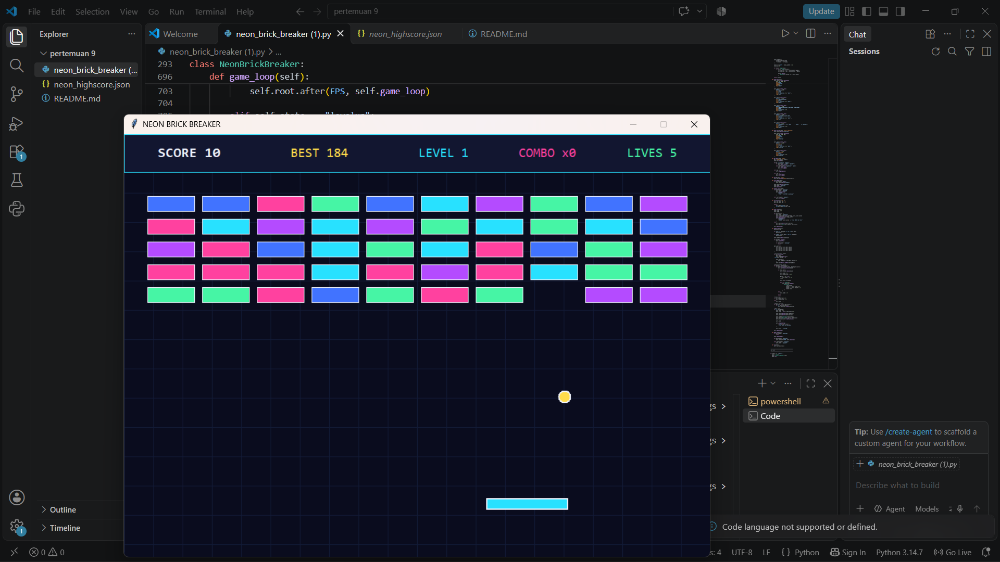

# NEON BRICK BREAKER 

## 1. Deskripsi Game
NEON BRICK BREAKER merupakan game arkade sederhana dengan konsep memantulkan bola menggunakan paddle untuk menghancurkan balok-balok. Game ini dikembangkan menggunakan Python dengan tampilan grafis Tkinter dan tema neon futuristik.

Pengembangan dilakukan dengan mengubah versi awal yang menggunakan Pygame menjadi versi Tkinter agar dapat dijalankan tanpa menginstal library tambahan seperti Pygame.

## 2. Teknologi yang Digunakan
- Bahasa pemrograman: Python 3.15.2
- GUI: Tkinter
- Penyimpanan skor: JSON
- Konsep pemrograman: Object Oriented Programming (OOP)

## 3. Modifikasi yang Dilakukan

Berikut beberapa perubahan dari kode program versi sebelumnya:

### A. Perubahan Library
- Menghapus penggunaan library Pygame.
- Menggunakan Tkinter sebagai pengganti untuk membuat tampilan game.
- Menggunakan Canvas untuk menggambar objek permainan.
- Tidak memerlukan instalasi Pygame.

### B. Perubahan Tampilan
- Mengubah sistem rendering dari Pygame menjadi Tkinter Canvas.
- Menggunakan tema warna neon futuristik.
- Menambahkan garis grid sebagai latar belakang.
- Membuat tampilan menu utama dan informasi permainan.
- Menggunakan warna berbeda untuk setiap balok.

### C. Modifikasi Sistem Permainan
- Mempertahankan sistem pergerakan paddle.
- Mempertahankan mekanisme pantulan bola.
- Menambahkan deteksi tabrakan antara bola, paddle, dan balok.
- Mempertahankan sistem penghancuran balok.
- Menambahkan peningkatan kecepatan berdasarkan level.

### D. Modifikasi Sistem Skor
- Mempertahankan sistem penghitungan skor.
- Menambahkan sistem combo ketika berhasil menghancurkan balok secara berurutan.
- Mempertahankan sistem high score.
- Menyimpan skor tertinggi secara otomatis menggunakan file JSON.

### E. Modifikasi Fitur Tambahan
- Mempertahankan sistem nyawa pemain sebanyak 5 nyawa.
- Menambahkan efek partikel ketika balok berhasil dihancurkan.
- Menambahkan sistem peningkatan level.
- Menambahkan fitur pause dan restart.
- Memberikan tambahan nyawa ketika pemain berhasil menyelesaikan satu level, maksimal 5 nyawa.

### F. Perubahan Struktur Program
Program menggunakan konsep Object Oriented Programming (OOP) dengan beberapa class:

1. **Striker**: Mengatur pergerakan dan posisi paddle.
2. **Ball**: Mengatur pergerakan bola dan mekanisme pantulan.
3. **Block**: Mengatur balok, warna, dan ketahanan balok.
4. **Particle**: Mengatur efek partikel ketika balok dihancurkan.
5. **NeonBrickBreaker**: Mengatur keseluruhan sistem permainan.

## 4. Kontrol Permainan

| Tombol | Fungsi |
|---|---|
| ENTER | Memulai atau melanjutkan permainan |
| ← / → | Menggerakkan paddle |
| A / D | Alternatif menggerakkan paddle |
| P | Pause permainan |
| R | Restart permainan |

## 5. Cara Menjalankan Program

1. Pastikan Python sudah terinstal.
2. Pastikan modul Tkinter tersedia.
3. Buka folder project melalui Visual Studio Code.
4. Buka file `neon_brick_breaker_tkinter.py`.
5. Jalankan program menggunakan perintah:

```bash
py -3.15 "neon_brick_breaker_tkinter.py"
```

Program tidak membutuhkan instalasi Pygame maupun library eksternal tambahan.

## 6. File dalam Project

- `neon_brick_breaker_tkinter.py`: File utama program game.
- `README.md`: Dokumentasi project.
- `neon_highscore.json`: File penyimpanan skor tertinggi yang dibuat otomatis setelah skor disimpan.

## 7. Kesimpulan

Modifikasi NEON BRICK BREAKER dilakukan dengan mengganti library Pygame menjadi Tkinter tanpa mengubah konsep utama permainan. Beberapa fitur seperti skor, nyawa, level, combo, efek partikel, dan penyimpanan high score tetap dipertahankan. Dengan perubahan ini, program menjadi lebih sederhana untuk dijalankan karena tidak memerlukan instalasi library tambahan seperti Pygame.
